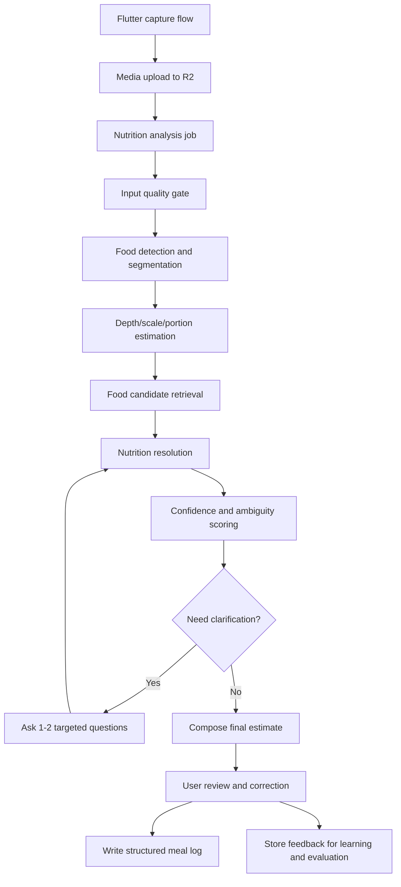

# 015 - Agentic Photo Calorie Analysis Architecture

## Goal
Design a photo-to-calories system that performs materially better than the current single-pass meal analyzer, fits the existing Ledger app/server architecture, and creates the data foundation required to keep improving over time.

This document is intentionally architecture-heavy. It focuses on product behavior, backend flow, model orchestration, confidence handling, and data design rather than implementation details.

## Executive Summary
The current system in Ledger is a good proof of concept:
- upload a meal photo
- run one multimodal model call
- return ingredients, macros, and confidence
- save the result against `meal_media_attachments`

That is fast, but it will not reliably reach near-Cal AI quality for real-world meals. The core reason is simple: calorie accuracy is dominated by portion estimation, cooking-method ambiguity, hidden fats, mixed dishes, and food variant ambiguity, not just object recognition.

The correct architecture is a staged hybrid system:
1. Capture the best possible input on-device, including depth when available.
2. Run a multi-step analysis pipeline instead of one all-purpose prompt.
3. Resolve detected foods against a canonical food catalog plus nutrition sources.
4. Ask 0 to 2 targeted clarification questions only when uncertainty materially changes calories.
5. Save every intermediate and final decision so user corrections become training and ranking data.

If built well, this can produce a much more trustworthy product. The realistic bar is:
- high food-identification accuracy for common meals
- strong calorie estimates for simple and moderately complex meals
- user-confirmed accuracy that becomes very strong over time

## Reality Check on the 95-99% Target
For unconstrained, open-world meal photos, a raw one-shot AI estimate will not reliably achieve 95-99% end-to-end calorie accuracy across all cuisines and meal formats. The hardest failures are:
- mixed dishes
- hidden oils, butter, ghee, sauces, and dressings
- food buried under other food
- uncertain scale and depth
- brand and ingredient variants
- restaurant portions with inconsistent preparation

A more defensible target is:
- 95%+ item identification on common foods in good photos
- 85-92% calorie accuracy for simple meals with strong scale/depth signals
- 90%+ user-confirmed logging accuracy after one clarification question when needed
- steadily improving personalized accuracy from correction data

So the product goal should not be "magically correct from one image every time." The goal should be "fast, trustworthy, low-friction logging that gets very close automatically and becomes highly accurate with minimal clarification."

## Current State in Ledger
Relevant current pieces already exist:
- `server/src/routes/media.ts`
  photo upload, stored privately in Cloudflare R2, with a synchronous `/:id/analyze` endpoint
- `server/src/lib/mealAnalyzer.ts`
  one Gemini structured-output call over the uploaded image
- `server/src/db/schema.ts`
  `meal_media_attachments`, `diet_quick_logs`, and `diet_meal_logs.rawPayload`
- `features/006-media-and-nutrition-intelligence-foundation.md`
  the original foundation-level feature note

Current gaps:
- no depth or scale-aware portion system
- no segmentation or per-item reasoning
- no canonical food resolution layer
- no clarification loop
- no audit trail for intermediate model decisions
- no learning loop from user corrections
- synchronous analysis path instead of worker-driven orchestration

## Updated Platform Research: Depth Acquisition Strategy
After reviewing the current platform capabilities, the depth strategy should be defined more precisely.

### Important corrections
- On Android, the two platform-native depth paths are:
  - `ARCore Depth API`
  - camera-level depth output where hardware supports it
- A generic `SensorManager` check for `TYPE_TOF` or `TYPE_DEPTH` is not a reliable primary abstraction for production depth capture. Android officially exposes depth more cleanly through ARCore and Camera2 camera capabilities.
- On iOS, for rear-camera scene depth suitable for food scanning, the reliable native path is LiDAR-backed ARKit / AVFoundation on LiDAR-equipped devices.
- ARCore is not the iOS depth strategy for this app. On iOS, if we keep the product decision simple, native depth should mean LiDAR only.
- "MDE" should be referred to as `monocular depth estimation`, not "Monochrome Dev Systemation."

### Recommended product policy by platform
#### iOS
Use this order:
1. LiDAR-backed native depth capture
2. If LiDAR is unavailable, skip native depth and fall back to image-only portion estimation with:
   - reference object guidance
   - plate/bowl priors
   - monocular depth estimation on the backend if needed

This matches your stated product direction: on iOS, native depth support is LiDAR only.

Tradeoff:
- simpler implementation
- strong quality on LiDAR devices
- weaker native depth coverage on non-Pro iPhones and non-LiDAR iPads

#### Android
Use this order:
1. Camera-level hardware depth output if the device exposes a usable depth-capable rear camera path
2. ARCore Depth API
3. Monocular depth estimation fallback

Practical note:
- In many Android cases, ARCore will be the first real-world depth path that matters.
- ARCore Depth API does not require a dedicated ToF sensor and, per Google’s supported-devices page, supported over 87% of active devices as of October 2025.
- Some Android devices also have hardware depth sensing, but that should be treated as an optimization path, not the baseline assumption.

### Why the platform split should look like this
iOS and Android are asymmetric:
- Apple gives a clean premium path on LiDAR hardware.
- Android gives broader coverage through ARCore depth-from-motion, sometimes enhanced by hardware depth sensors.

So the architecture should not force a fake "same depth pipeline" on both platforms. It should normalize outputs after acquisition, not before.

### Normalized depth contract
Regardless of source, the mobile layer should pass a common payload into the backend:
- `depth_source`
  lidar_native, camera_depth_output, arcore_depth, monocular_estimated, none
- `depth_confidence`
- `depth_resolution`
- `camera_intrinsics_json`
- `depth_object_key` or embedded upload reference
- `capture_motion_state`
  stationary, short_scan, full_scan

The backend should not care whether the depth came from LiDAR or ARCore after this normalization step.

## Product Outcome We Actually Want
From a user perspective, the ideal flow is:
1. User takes or uploads a meal photo.
2. App captures extra context when available:
   - depth map
   - device type
   - camera metadata
   - whether a reference object is present
   - meal slot and time
3. System returns a first estimate quickly.
4. If uncertainty materially affects calories, the app asks one short question:
   - "Is this paneer regular, low-fat, or fat-free?"
   - "Was this cooked mostly in oil, little oil, or almost no oil?"
5. User sees itemized foods, portion estimates, calories, and macros.
6. User confirms or edits.
7. Confirmed result is logged into the diet system and stored as training-quality feedback.

The product should feel instant for the first answer, but rigorous underneath.

## Architecture Principles
1. Build a pipeline, not a monolith.
   One giant prompt is useful for a prototype, but not for a production nutrition system.

2. Separate perception from resolution.
   Detecting "paneer cubes in curry" is different from deciding which nutrition record best matches them.

3. Treat uncertainty as a first-class object.
   The system should know when it is unsure, why, and whether it should ask the user something.

4. Store raw and normalized data.
   If intermediate decisions are lost, the system cannot improve.

5. Make the final answer auditable.
   Every logged calorie number should be traceable to image evidence, candidate foods, portion assumptions, and user corrections.

6. Prefer deterministic business logic around model outputs.
   Models should produce structured evidence; ranking, thresholds, question policy, and logging should be controlled by backend logic.

## Proposed System Overview

## Recommended Pipeline

### Stage 1: Capture and Context Collection
The app should capture more than a JPEG.

Preferred capture payload:
- image file
- optional depth map or scene depth frame
- image width and height
- device platform and model
- camera focal length or intrinsics if accessible
- EXIF orientation
- timestamp
- meal context
  breakfast, lunch, dinner, snack, post-workout, restaurant, home-cooked
- user-declared hints
  cuisine, "contains paneer", "protein meal", "restaurant food"
- reference-object presence
  hand, spoon, fork, known plate template, card-sized guide
- depth acquisition metadata
  source, confidence, scan duration, calibration availability

Why this matters:
- depth and intrinsics materially improve volume estimation
- context narrows likely food candidates
- meal type and time can bias retrieval without hardcoding the answer

#### Platform-specific capture guidance
For this product, the mobile layer should follow a deterministic platform policy:

On iOS:
- attempt LiDAR-backed capture only on supported devices
- do not build an intermediate non-LiDAR native depth path for v1
- if LiDAR is unavailable, proceed with image capture plus scale/reference guidance

On Android:
- first check whether the selected rear camera path exposes usable depth output
- otherwise use ARCore Depth API when supported
- otherwise capture a standard image and mark the request for monocular depth fallback

This keeps the mobile logic simple and avoids pretending all devices can provide equally trustworthy depth.

### Stage 2: Pre-Processing and Quality Gate
Before nutrition inference, run a light pre-processing pass:
- blur detection
- low-light detection
- cropping validation
- food-present / no-food check
- duplicate image detection by perceptual hash

Outputs:
- quality score
- reject / retry suggestion if image is too poor
- image normalization metadata

If the image is low confidence from the start, the app should ask for another photo rather than pretending to be accurate.

### Stage 3: Food Detection and Segmentation
Instead of asking one model for the whole meal, first decompose the scene into food components.

The detection layer should produce:
- food regions or masks
- coarse food labels
- plating structure
  plate, bowl, cup, tray, multiple containers
- countable vs amorphous item type
  idli is countable; dal is amorphous

This stage can be powered by:
- a multimodal model for coarse scene reasoning
- a segmentation model for food boundaries
- a specialized detector later, once enough internal data exists

The main output is not calories. It is a structured list of visible components with evidence.

### Stage 4: Scale, Depth, and Portion Estimation
This is the most important technical stage for calorie quality.

Portion estimation strategy by priority:
1. Native LiDAR depth on supported iOS devices
2. Android camera-level hardware depth output when exposed cleanly
3. Android ARCore Depth API on supported devices
4. Reference object scale
5. Plate or bowl template estimation
6. Monocular depth estimation fallback
7. Population priors when all else fails

Important nuance:
- ARCore depth is often depth-from-motion and may also incorporate hardware depth when available.
- Because of that, ARCore should be treated as a strong practical source of depth, but not equivalent to dense high-quality LiDAR in all conditions.
- Monocular depth estimation is useful for relative shape and coarse thickness, but it still needs scale anchors for real-world volume.

For each detected item, estimate:
- volume in ml or cubic cm for amorphous foods
- count for discrete foods
- surface area and thickness if useful
- estimated grams after density conversion
- uncertainty interval

The system should also infer container geometry:
- round plate
- deep bowl
- takeaway box
- cup or glass

This stage needs food-specific density priors:
- rice, dal, paneer cubes, curries, fries, nuts, smoothies, bread, etc.

Without density priors, volume alone is not enough.

#### Platform output requirements
The portion subsystem should score depth quality before using it:
- `high`
  LiDAR or clean hardware depth with calibration
- `medium`
  ARCore depth with stable tracking and enough motion
- `low`
  monocular depth plus reference object
- `very_low`
  plate priors only

The final calorie confidence should be penalized when portion estimation depends on low-quality depth.

### Stage 5: Canonical Food Candidate Retrieval
Once the system knows what is visible, it needs to map each item to likely nutrition records.

For each detected item:
1. Build a normalized description
   - "paneer tikka, grilled, moderate oil"
   - "basmati rice, cooked"
   - "dal makhani, restaurant-style"
2. Retrieve candidates from the food catalog and external nutrition sources.
3. Rank candidates based on:
   - visual match
   - cuisine context
   - user history
   - meal timing
   - generic vs branded likelihood
   - home vs restaurant context

This is where the system decides whether the item is:
- generic food
- recipe-like dish
- packaged or branded food
- custom food the user commonly eats

### Stage 6: Nutrition Resolution
This stage converts identified foods and portion estimates into calories and macros.

Resolution logic:
- choose the best candidate nutrition record
- convert serving-based values into grams
- apply portion multipliers
- adjust for cooking method if known
- aggregate item-level totals into meal totals

Important rule:
The system should preserve both:
- raw candidate values from the source nutrition record
- transformed final values after portion and cooking adjustments

That audit trail is critical for debugging and future retraining.

### Stage 7: Clarification Agent
This is the agentic layer that makes the system meaningfully better.

The clarification agent should only ask a question when:
- the top candidates are materially different in calories or macros
- a hidden preparation variable is likely
- the ambiguity cannot be resolved visually
- the expected accuracy gain is worth the extra friction

Question budget:
- default: zero questions
- allowed: one question for most meals
- maximum: two short questions for high-impact ambiguity

Good question types:
- ingredient variant
  "Was the paneer regular, low-fat, or fat-free?"
- cooking method
  "Was this fried, sauteed, or grilled?"
- fat usage
  "Was this cooked with a lot of oil, some oil, or very little oil?"
- milk/base type
  "Was this full-fat milk, toned milk, or skim milk?"
- count confirmation
  "Was that 2 rotis or 3?"

Bad question types:
- questions the user cannot answer easily
- questions about low-calorie garnish details
- open-ended questions that slow down logging

The clarification agent should optimize for expected calorie error reduction, not curiosity.

### Stage 8: Final Composition and Review
The final response shown to the user should include:
- meal-level calories and macros
- itemized foods
- grams or counts per item
- confidence and uncertainty signals
- the one most likely correction opportunity, if any

The UI should make it easy to:
- accept all
- edit one item
- change portion
- answer a clarification question
- swap the matched food record

### Stage 9: Feedback Capture and Learning Loop
Every user correction should be treated as supervision.

High-value feedback signals:
- item renamed
- portion changed
- cooking method changed
- branded item selected
- calories/macros manually overridden
- clarification answer changed the final result
- estimate accepted without edits

This data should feed:
- retrieval ranking improvements
- question policy tuning
- personalized priors
- offline evaluation sets
- future specialized model training

## Recommended Agent Architecture
Do not build this as a fully autonomous free-form agent. Build it as a controlled orchestrator with specialized structured stages.

Recommended logical agents:

### 1. Orchestrator
Responsibilities:
- create analysis job
- run stages in order
- decide whether to fan out or retry
- manage timeouts and fallbacks
- persist intermediate state

### 2. Vision Analyst
Responsibilities:
- inspect image globally
- identify meal context
- propose visible foods
- detect ambiguity hotspots

Output:
- scene summary
- coarse item list
- likely cuisine and dish family

### 3. Segmenter / Portion Estimator
Responsibilities:
- isolate items
- estimate count, area, volume, grams
- emit uncertainty per item

Output:
- per-item geometry and mass estimates

### 4. Food Resolver
Responsibilities:
- retrieve candidate foods
- score matches
- pick best nutrition source record
- attach source provenance

Output:
- ranked candidates and chosen record

### 5. Clarification Agent
Responsibilities:
- inspect ambiguity
- estimate expected gain from asking
- generate a short, closed-ended question
- apply the answer back to the resolver

Output:
- zero, one, or two clarification prompts with selectable options

### 6. Nutrition Composer
Responsibilities:
- compute final item macros
- aggregate totals
- generate user-facing explanation and confidence

Output:
- final structured meal analysis

### 7. QA / Policy Layer
Responsibilities:
- block obviously wrong outputs
- detect contradictions
  example: "grilled chicken" with impossible carb values
- enforce schema and confidence thresholds

This is better than one general agent because it is inspectable, testable, and easier to improve stage by stage.

## Database and Data Model Plan
This is the most important long-term section. If the data model is weak, the system cannot improve.

The current tables are a useful start:
- `meal_media_attachments`
- `diet_quick_logs`
- `diet_meal_logs`

They are not sufficient for a serious learning system. The analysis pipeline needs additional structured entities.

### 1. Extend `meal_media_attachments`
Purpose:
store immutable capture-level facts about the image and its processing context

Recommended fields:
- `width`
- `height`
- `sha256`
- `capture_source`
  camera, gallery, imported, meal-plan-log, quick-log
- `device_platform`
- `device_model`
- `capture_context_json`
  meal slot, restaurant/home, hint text, cuisine hint
- `exif_json`
- `depth_object_key`
  pointer to stored depth map if present
- `depth_status`
  none, native, inferred
- `quality_score`
- `quality_flags_json`
- `latest_analysis_run_id`

### 2. Add `diet_analysis_runs`
Purpose:
one record per analysis attempt or pipeline version run

Recommended fields:
- `id`
- `user_id`
- `attachment_id`
- `status`
  queued, running, needs_clarification, completed, failed, cancelled
- `pipeline_version`
- `trigger_source`
  quick-log, meal-plan-log, reanalyze, evaluation
- `primary_vision_model`
- `segmentation_model`
- `depth_model`
- `resolver_version`
- `started_at`
- `completed_at`
- `latency_ms`
- `error_code`
- `error_detail_json`
- `summary_json`

Why this matters:
- the same attachment may be reanalyzed as models improve
- you need versioned evaluation, not one mutable blob

### 3. Add `diet_analysis_items`
Purpose:
store each detected food component within a run

Recommended fields:
- `id`
- `analysis_run_id`
- `parent_item_id`
  useful for combo dishes or grouped items
- `item_index`
- `visible_label`
  what the vision layer thinks it sees
- `item_type`
  countable, amorphous, beverage, packaged, condiment
- `bbox_json`
- `mask_object_key` or `mask_json`
- `visual_confidence`
- `count_estimate`
- `volume_ml`
- `weight_g`
- `weight_low_g`
- `weight_high_g`
- `density_profile_id`
- `cooking_method_guess`
- `preparation_guess`
- `notes_json`

### 4. Add `diet_item_candidates`
Purpose:
preserve the ranked food matches considered during resolution

Recommended fields:
- `id`
- `analysis_item_id`
- `source_type`
  USDA, internal, OpenFoodFacts, FatSecret, user-custom
- `source_food_id`
- `candidate_name`
- `candidate_brand`
- `calories_per_100g`
- `protein_per_100g`
- `carbs_per_100g`
- `fat_per_100g`
- `match_score`
- `selection_reason_json`
- `selected`

Why this matters:
- future retrieval tuning
- offline analysis of bad matches
- explainability

### 5. Add `diet_clarification_questions`
Purpose:
capture the exact ambiguity and the user answer

Recommended fields:
- `id`
- `analysis_run_id`
- `analysis_item_id`
- `question_key`
  paneer_fat_level, oil_amount, milk_type, portion_count
- `question_text`
- `options_json`
- `selected_option`
- `impact_score`
  estimated error reduction if answered
- `asked_at`
- `answered_at`
- `skipped_at`

### 6. Add `diet_analysis_final_items`
Purpose:
store the resolved, user-facing line items that are eventually logged

Recommended fields:
- `id`
- `analysis_run_id`
- `canonical_food_id`
- `display_name`
- `quantity_value`
- `quantity_unit`
- `weight_g`
- `calories`
- `protein_g`
- `carbs_g`
- `fat_g`
- `confidence`
- `source_summary_json`

This lets you preserve the final normalized output separately from the raw detection layer.

### 7. Add or formalize a `canonical_food_catalog`
Purpose:
create a normalized food layer above raw third-party nutrition records

Recommended fields:
- `id`
- `canonical_name`
- `aliases_json`
- `cuisine_tags_json`
- `food_type`
- `generic_or_branded`
- `brand_name`
- `serving_profiles_json`
- `density_profiles_json`
- `nutrition_per_100g_json`
- `variant_group`
  paneer, milk, yogurt, bread, rice, oil
- `is_user_custom`
- `source_priority_json`
- `embedding_vector`
  if you later use vector retrieval

This is the layer that makes "low-fat paneer" vs "regular paneer" manageable.

### 8. Add `diet_analysis_feedback`
Purpose:
turn edits and accepts into learning signals

Recommended fields:
- `id`
- `analysis_run_id`
- `user_id`
- `feedback_type`
  accepted, edited_item, changed_portion, changed_candidate, manual_override, rejected
- `before_json`
- `after_json`
- `created_at`

### 9. Add `diet_ground_truth_samples`
Purpose:
curate high-quality evaluation examples from production and test kitchens

Recommended fields:
- `id`
- `attachment_id`
- `source`
  internal-test, user-consented, restaurant-sample
- `ground_truth_json`
- `verification_method`
  weighed, label-scanned, recipe-known, manually-nutritionist-reviewed
- `quality_grade`

This is how you measure whether the system is actually getting better.

## What Data Must Be Preserved
If you want a system that improves materially over time, these are non-negotiable:
- original image reference
- optional depth reference
- capture metadata
- raw scene summary
- per-item detection output
- per-item portion estimate with uncertainty
- candidate foods considered
- chosen nutrition record and source
- clarification questions and answers
- final user-confirmed line items
- what the user changed
- model versions and pipeline version
- latency and cost per run

The current single `ai_analysis_result` blob is useful for a prototype but not enough for continuous improvement.

## Nutrition Data Strategy
The system should not depend on one source.

Recommended nutrition source hierarchy:
1. Internal canonical food catalog
2. USDA FoodData Central for generic foods
3. Region-specific composition data for Indian foods
4. OpenFoodFacts or branded-food providers for packaged items
5. User custom foods and recurring meals

The resolution layer should unify all of these into one canonical format.

Why this matters for India-heavy use cases:
- paneer, dal, sabzi, biryani, poha, dosa, idli, roti, paratha, chutneys, gravies, and sweets often map poorly if the system relies only on US-centric generic nutrition sources
- restaurant-style and home-style Indian dishes can differ drastically because of oil, cream, ghee, and sugar content

So the catalog strategy should include:
- Indian dish aliases
- preparation style variants
- restaurant vs home priors
- density defaults for common Indian foods

## Clarification Policy Design
This is where the product becomes much better without becoming annoying.

The backend should compute a clarification score based on:
- calorie spread between top candidates
- macro spread between top candidates
- confidence of visual recognition
- confidence of portion estimate
- expected UX friction
- whether the user has answered similar questions before

Suggested rules:
- ask nothing if projected calorie uncertainty is small
- ask one question if it reduces expected calorie error by at least 10-15%
- ask a second question only for very high-impact ambiguity
- never ask more than two questions in one logging flow

Examples:
- paneer type
  ask, because regular vs low-fat can matter a lot
- full-fat vs skim milk
  ask for beverages and shakes
- fried vs grilled
  ask for cutlets, paneer, chicken, fish
- "extra oil?" for curries or stir-fries
  ask when visible sheen is ambiguous
- ketchup garnish
  do not ask

## Personalization Layer
Accuracy improves a lot if the system remembers the user.

The resolver should use soft personalization signals:
- foods the user logs repeatedly
- foods common in the user’s region
- dietary preference
  vegetarian, eggetarian, vegan
- previously answered clarification choices
- usual portion sizes
- home-cooked vs restaurant behavior

Examples:
- if a user is vegetarian and often logs paneer bhurji, the resolver should rank paneer-based candidates above chicken-based lookalikes
- if a user repeatedly changes "milk" to "skim milk," that should become a prior

These are priors, not hard constraints.

## Connection to the Existing Ledger App

### Mobile App
Recommended app-level additions:
- better meal capture UI with framing guidance
- optional "include spoon/hand for scale" hint on unsupported depth devices
- capture flow that stores context before upload
- review UI with itemized foods, portions, and clarification cards
- quick confirm path for high-confidence meals

Recommended user states:
- analyzing
- needs one answer
- ready to confirm
- saved
- low-confidence retry needed

### Backend
Recommended backend evolution from current implementation:
- keep `POST /api/diet/media/upload`
- change `POST /api/diet/media/:id/analyze` from a synchronous heavy call into job creation
- process analysis in a worker queue
- add endpoints for:
  - polling analysis status
  - submitting clarification answers
  - confirming final analysis
  - reanalyzing with a newer pipeline version

This aligns well with the existing Redis/BullMQ setup already present in the server.

### Mobile-Native Bridge Strategy
Because this app is Flutter, depth acquisition should be isolated behind a small platform bridge rather than leaking platform-specific details into the Dart nutrition flow.

Recommended contract:
- one depth service interface in Flutter
- one platform channel per platform implementation
- one cached "best available depth method" result per device

Recommended cached values:
- `ios_lidar`
- `android_camera_depth`
- `android_arcore_depth`
- `monocular_only`
- `no_depth_available`

Important product decision:
- cache capability detection
- do not cache the actual depth result between captures
- do not skip re-checking if the user changes camera mode or permissions state

The goal of caching is to avoid repeated expensive initialization, especially on Android if a device is known to be image-only or ARCore-incompatible.

### Logging Integration
Final confirmed analysis should flow into:
- `diet_quick_logs` for standalone logged meals
- `diet_meal_logs` for plan-linked actual intake

Important change in philosophy:
- the meal log should reference a final normalized analysis artifact
- the analysis artifact should remain immutable
- user edits should be preserved as corrections, not overwrite history blindly

That gives you auditability and future learning value.

## Recommended Rollout Plan

### Phase 0: Instrument the Current System
Objective:
measure how bad the current system is before replacing it

Deliverables:
- save more metadata around current analyses
- record user edits and acceptance rate
- define a small gold-standard evaluation set

### Phase 1: Move to Async Multi-Stage Pipeline
Objective:
replace the synchronous one-shot analyzer with a worker-driven staged flow

Deliverables:
- analysis job table
- status polling
- stage outputs persisted separately
- first-pass improved schema

### Phase 2: Add Portion Intelligence
Objective:
materially improve calorie accuracy by improving grams estimation

Deliverables:
- capture context
- platform-specific depth support on capable devices
- reference object fallback
- density profile system
- normalized depth contract across iOS and Android

### Phase 3: Add Clarification Agent
Objective:
reduce the biggest ambiguity errors without increasing friction too much

Deliverables:
- question policy
- answer submission flow
- ambiguity-driven re-resolution

### Phase 4: Build Canonical Food Resolver
Objective:
stop depending on raw generic nutrition matches

Deliverables:
- normalized food catalog
- Indian-food coverage strategy
- candidate ranking based on context and user history

### Phase 5: Feedback and Evaluation Loop
Objective:
turn production usage into measurable quality improvements

Deliverables:
- accepted vs corrected logging metrics
- correction capture pipeline
- offline benchmark dashboard
- retraining and reranking data exports

### Phase 6: Specialized Models Where They Actually Help
Objective:
selectively introduce dedicated CV models only after enough data exists

Deliverables:
- better segmentation
- better monocular depth fallback
- custom retrieval or food classification improvements

This is the right order. Do not start by training a custom end-to-end calorie model from scratch.

## Success Metrics
Measure the system on separate axes.

### User Metrics
- meal logging completion rate
- average time to confirm meal
- percentage of meals accepted without edits
- percentage of analyses requiring clarification
- user satisfaction with photo logging

### Quality Metrics
- item identification precision and recall
- portion estimation mean absolute percentage error
- meal calorie mean absolute percentage error
- macro error by meal type
- correction rate by cuisine and food category

### Operational Metrics
- median and p95 analysis latency
- cost per successful analysis
- worker failure rate
- retry rate
- low-confidence retry rate

### Learning Metrics
- retrieval top-1 and top-3 candidate hit rate
- clarification answer usefulness
- accuracy lift from personalization
- accuracy lift from depth vs no depth

## Hard Problems to Expect
- mixed dishes like biryani, pulao, pasta bowls, and curries
- hidden oil, butter, cream, and ghee
- restaurant foods with inconsistent recipes
- partial or occluded images
- drinks with unknown sweeteners and milk types
- desserts and sweets with highly variable density
- similar-looking foods with very different macros

The architecture should explicitly expect these cases instead of pretending the vision model will magically solve them.

## Recommended Product Guardrails
- never show false precision like `437 kcal` when uncertainty is high
- show ranges internally even if the UI rounds the primary number
- encourage retake for bad images
- ask only high-value questions
- default to conservative wording when confidence is low
- preserve user trust over appearing overly smart

## Recommendation for Ledger Specifically
For this app, the highest-leverage strategy is:
1. Keep the current upload and private R2 model.
2. Replace the single-call meal analyzer with an async staged pipeline.
3. Introduce structured analysis tables before adding more models.
4. Add clarification questions for high-impact ambiguity like paneer type, oil usage, milk type, and countable items.
5. Build a canonical food layer with strong Indian-food coverage.
6. Treat every confirmed or corrected meal as training data.

That path is much more realistic than aiming for a magical end-to-end AI model immediately.

## Final Recommendation
The fastest path to a genuinely strong product is:
- multimodal LLM for scene understanding
- depth-aware or scale-aware portion estimation
- canonical nutrition resolver
- targeted clarification agent
- immutable structured logging
- continuous improvement from user feedback

That combination can produce a system that feels far more accurate than the current one, especially for repeat users, even if the raw first-pass photo estimate is not perfect.

The key strategic point is this:
Calorie AI becomes strong when the product is designed as a learning system, not when it is designed as a single prompt.
